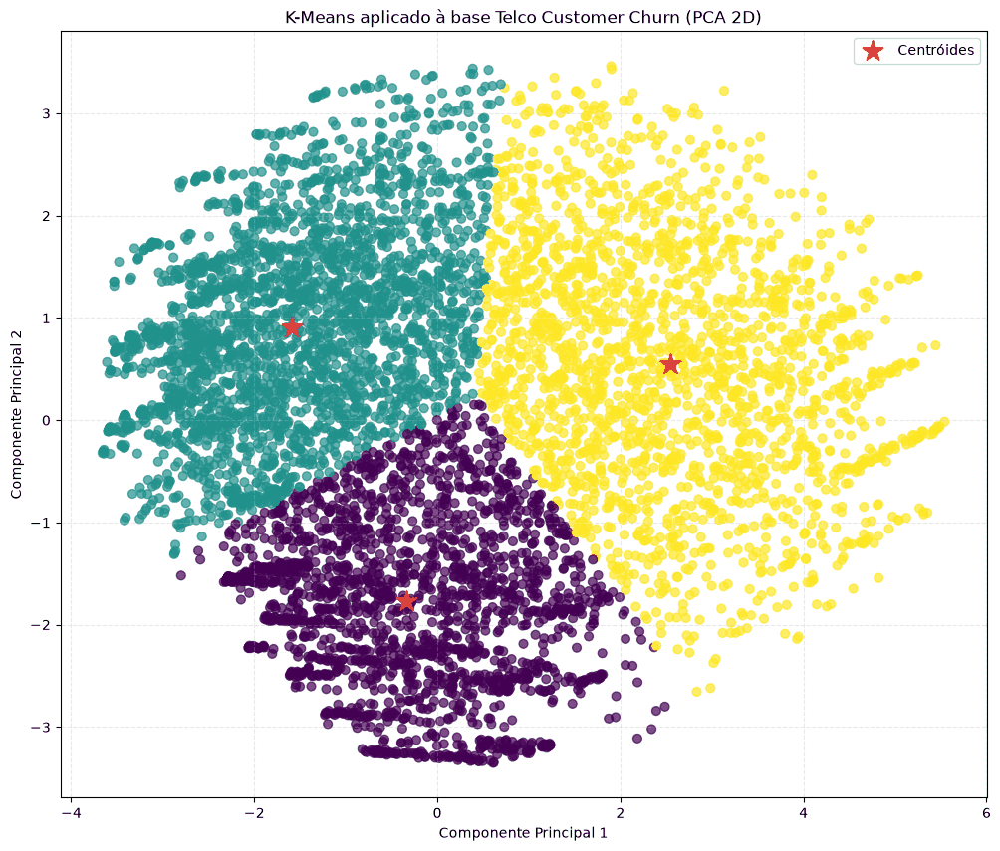

# K-Means

## Objetivos

- Aplicar **K-Means** para agrupar os clientes da base de churn (aprendizado não supervisionado).
- Entender a **intuição matemática** do algoritmo.
- Explorar **perfis de clientes** e a **taxa de churn por cluster** para identificar grupos de maior risco.

A base utilizada é a versão **pré-processada** (ver [Árvore de Decisão](../roteiro1/main.md#pre-processamento)).

## Intuição do K-Means aplicada à base

Cada cliente é um vetor de características (`tenure`, `MonthlyCharges`, `TotalCharges`, serviços contratados etc.). O K-Means particiona os clientes em *k* grupos minimizando a soma das distâncias quadradas até o centróide de cada grupo:

\[
J = \sum_{i=1}^{k} \sum_{x \in C_i} \lVert x - \mu_i \rVert^2
\]

onde \( C_i \) é o conjunto de clientes do cluster *i*, \( x \) é o vetor do cliente e \( \mu_i \) é o centróide do cluster.

Depois da clusterização, cruzamos os grupos com a variável **Churn** (que não entra no treino) para encontrar **segmentos de maior risco de cancelamento**.

## Preparação

1. Remoção de `Churn` da matriz de entrada.
2. Padronização com **StandardScaler** — sem isso, `TotalCharges` dominaria a distância.
3. Redução para 2 componentes com **PCA** (`random_state=42`), o que permite visualizar os grupos em 2D.

## Escolha do número de clusters

Testamos *k* de 2 a 8 com o **método do cotovelo** (inércia) e o **silhouette score**:

``` python exec="on" html="on"
import pandas as pd
from sklearn.cluster import KMeans
from sklearn.decomposition import PCA
from sklearn.metrics import silhouette_score
from sklearn.preprocessing import StandardScaler

df = pd.read_csv("data/Customer-Churn-preprocessed.csv")
X_pca = PCA(n_components=2, random_state=42).fit_transform(StandardScaler().fit_transform(df.drop(columns=["Churn"])))

linhas = []
for k in range(2, 9):
    km = KMeans(n_clusters=k, init="k-means++", n_init=10, random_state=42).fit(X_pca)
    linhas.append({
        "k": k,
        "inércia": round(km.inertia_),
        "silhouette": round(silhouette_score(X_pca, km.labels_, sample_size=3000, random_state=42), 3),
    })
print(pd.DataFrame(linhas).to_html(index=False))
```

O **maior silhouette ocorre em k = 3**, que também fica na região do "cotovelo" da inércia. Por isso o estudo usa **k = 3**.

## Taxa de churn e perfil médio por cluster

``` python exec="on" html="on"
import pandas as pd
from sklearn.cluster import KMeans
from sklearn.decomposition import PCA
from sklearn.preprocessing import StandardScaler

df = pd.read_csv("data/Customer-Churn-preprocessed.csv")
X_pca = PCA(n_components=2, random_state=42).fit_transform(StandardScaler().fit_transform(df.drop(columns=["Churn"])))
df["cluster"] = KMeans(n_clusters=3, init="k-means++", max_iter=100, random_state=42).fit_predict(X_pca)

perfil = df.groupby("cluster").agg(
    clientes=("Churn", "size"),
    taxa_churn=("Churn", "mean"),
    tenure_medio=("tenure", "mean"),
    mensalidade_media=("MonthlyCharges", "mean"),
    total_medio=("TotalCharges", "mean"),
    contrato_medio=("Contract", "mean"),
)
print(perfil.to_html(float_format="%.2f"))
```

`Contract` está codificado como 0 = mês a mês, 1 = um ano e 2 = dois anos.

## Interpretação

| Cluster | Perfil | Risco |
| --- | --- | --- |
| **1** | Clientes novos (~14 meses), mensalidade média-alta (~US$ 68) e contrato quase sempre **mês a mês** | **Alto** — cerca de **48%** cancelam |
| **2** | Clientes antigos (~57 meses), mensalidade alta (~US$ 92) e contratos de 1–2 anos | Baixo (~16%) |
| **0** | Tempo de casa intermediário, mensalidade baixa (~US$ 34) e contratos longos | Muito baixo (~8%) |

O segmento de maior risco é bem definido: **clientes recentes, com contrato mensal e mensalidade elevada**. É o público prioritário para ações de retenção (por exemplo, incentivo à migração para contrato anual).

=== "Clusters no plano PCA"
    

=== "Código"
    ``` python
    --8<-- "docs/roteiro3/K-meansPlot.py"
    ```
