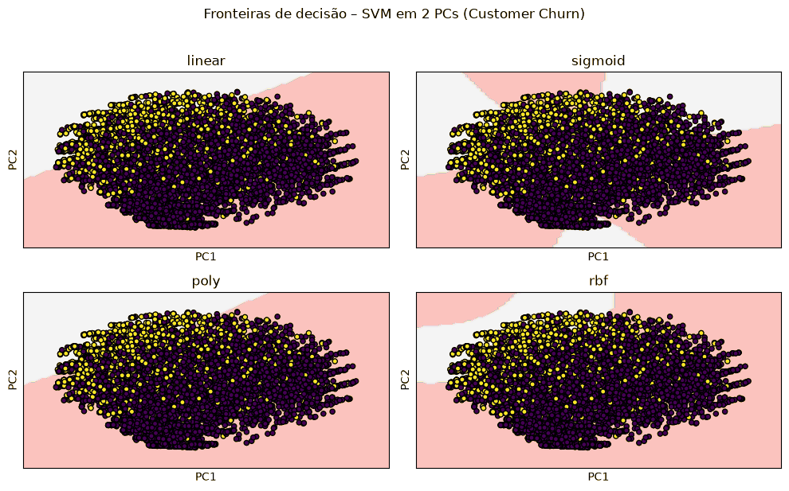

# SVM (Support Vector Machine)

## Contexto

Foi treinado um **SVM com kernel RBF** para classificar clientes em churn (1) e não churn (0) a partir da base pré-processada, com padronização (`StandardScaler`), divisão 80/20 estratificada e `class_weight="balanced"` para compensar o desbalanceamento das classes. A avaliação usa **1.409 clientes** de teste.

## Resultados

**Matriz de confusão**

| | Previsto: não churn | Previsto: churn |
| --- | --- | --- |
| **Real: não churn** | 760 (VN) | 275 (FP) |
| **Real: churn** | 86 (FN) | 288 (VP) |

**Métricas por classe**

| Classe | Precisão | Recall | F1 | Suporte |
| --- | --- | --- | --- | --- |
| 0 – não churn | 0,90 | 0,73 | 0,81 | 1035 |
| 1 – churn | 0,51 | **0,77** | 0,61 | 374 |
| Média macro | 0,70 | 0,75 | 0,71 | 1409 |
| Média ponderada | 0,80 | 0,74 | 0,76 | 1409 |

**Métricas globais:** acurácia **0,744** · ROC-AUC **0,818**

## Interpretação

- **Recall de churn = 0,77:** o modelo identifica 77% dos clientes que realmente cancelam — bom para retenção.
- **Precisão de churn = 0,51:** metade dos clientes sinalizados não cancelaria, o que gera custo com ações mal direcionadas (275 falsos positivos).
- **ROC-AUC = 0,82:** boa capacidade de ordenar clientes por risco.
- A acurácia (0,74) não é a métrica principal, porque a base é desbalanceada (≈ 26% de churn).

## Avaliação crítica

**Pontos fortes**

- Alta taxa de detecção de churners.
- ROC-AUC consistente para ranqueamento de risco.
- O kernel RBF captura relações não lineares.

**Limitações**

- Precisão moderada na classe positiva.
- Probabilidades podem exigir calibração.
- Hiperparâmetros (`C`, `gamma`) não foram otimizados.

## Próximos passos

- Ajustar o limiar de decisão conforme o custo de FP × FN.
- `GridSearchCV` para `C` e `gamma`.
- Calibrar probabilidades com `CalibratedClassifierCV`.
- Comparar com regressão logística, Random Forest e gradient boosting.

## Conclusão

O SVM com kernel RBF teve o melhor equilíbrio entre os modelos supervisionados do estudo para a classe churn (recall 0,77, ROC-AUC ≈ 0,82), sendo adequado como **filtro de risco** para campanhas de retenção, desde que o limiar seja ajustado para reduzir falsos positivos.

=== "Fronteiras por kernel (PCA 2D)"
    

=== "Curva ROC"
    
